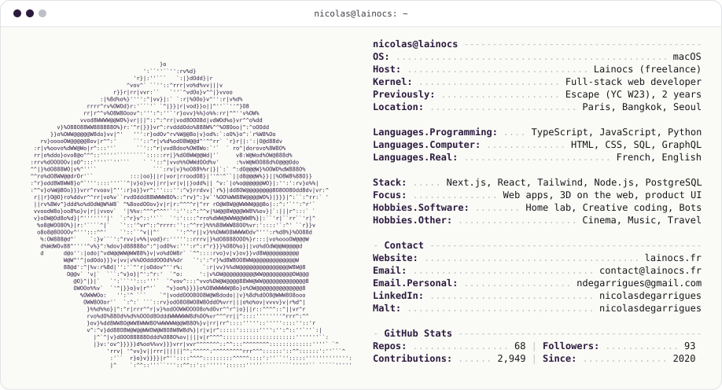

<a href="https://lainocs.fr">
  <picture>
    <source media="(prefers-color-scheme: dark)" srcset="dark_mode.svg">
    
  </picture>
</a>

<a href="https://lainocs.fr"><picture><source media="(prefers-color-scheme: dark)" srcset="link_portfolio_dark.svg"></picture></a><a href="https://www.linkedin.com/in/nicolasdegarrigues"><picture><source media="(prefers-color-scheme: dark)" srcset="link_linkedin_dark.svg"></picture></a><a href="https://www.malt.fr/profile/nicolasdegarrigues"><picture><source media="(prefers-color-scheme: dark)" srcset="link_malt_dark.svg"></picture></a>

<picture>
  <source media="(prefers-color-scheme: dark)" srcset="pacman_dark.svg">
  
</picture>

## À propos

Développeur web freelance à Paris, en renfort des agences et au service des commerces.

J'interviens sur vos projets comme un membre de l'équipe, y compris en marque blanche : vos clients ne voient que vous. Pour un commerce, je construis un site qui lui ressemble, rapide et facile à faire évoluer. Je réponds sous 24 h.

Avant de me lancer, j'ai passé deux ans comme développeur chez [Escape](https://escape.tech) (YC W23), une startup parisienne spécialisée dans la sécurité des API.

## Projets

| Projet | Nature | Ce que ça montre | Lien |
| --- | --- | --- | --- |
| **Pulsar** | Projet perso | Mes statistiques Spotify en direct : écoute en cours, artistes et titres du moment, via l'API Spotify. | [pulsar.lainocs.fr](https://pulsar.lainocs.fr) |
| **Vidéoclub 3D** | Projet perso | Un vidéoclub à explorer dans le navigateur, avec ma watchlist Letterboxd sur les étagères. | [videoclub.lainocs.fr](https://videoclub.lainocs.fr) |
| **Maison Corbière** | Commande fictive | Boucherie artisanale : commande à l'avance, découpe du bœuf interactive en 3D. | [butcher.lainocs.fr](https://butcher.lainocs.fr) |
| **Onggi** | Commande fictive | Cantine coréenne : carte filtrable avec allergènes, réservation, site en trois langues. | [korean.lainocs.fr](https://korean.lainocs.fr) |
| **Léa Marchetti** | Commande fictive | Photographe : galeries plein écran, demande de devis détaillée. | [photo.lainocs.fr](https://photo.lainocs.fr) |
| **Clinique des Murs-à-Pêches** | Commande fictive | Clinique vétérinaire : prise de rendez-vous, page urgences. | [veto.lainocs.fr](https://veto.lainocs.fr) |

Les commandes fictives sont des sites de commerces construits comme de vraies commandes.

Un projet ou besoin de renfort ? Écrivez-moi, je réponds sous 24 h.

La carte et le graphe sont régénérés chaque jour par une GitHub Action (voir <code>tools/</code>). Idée de la carte : le profil d'<a href="https://github.com/Andrew6rant">Andrew6rant</a>.
